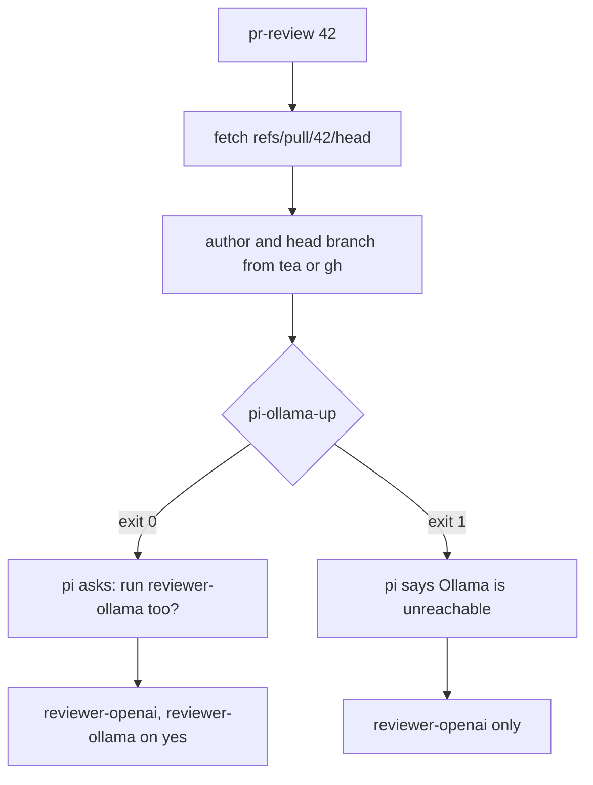
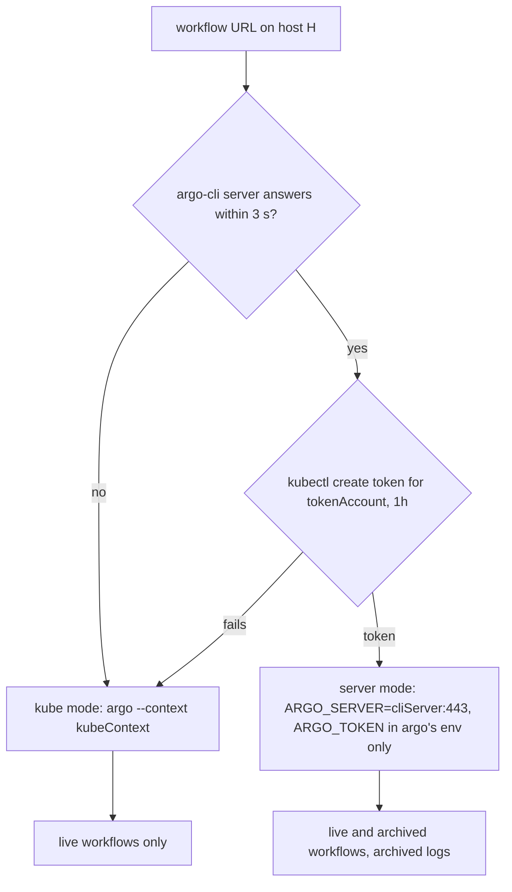

# Agent PR flow

This document describes the end-to-end pull-request workflow configured in this
repository: how a task becomes a branch, how multiple coding agents work on it in
parallel, and how a PR gets reviewed and commented on — for both **Codeberg**
(the primary forge) and **GitHub** (mirrors and GitHub-only repos).

The whole flow is built on **[workmux](https://github.com/raine/workmux)** (git
worktrees + tmux sessions) plus a set of small helper scripts. Authoring agents
(`claude`, `codex`) are independent CLIs, each in its own tmux pane. PR review
runs one `pi` session in a pane, which orchestrates in-process reviewer
sub-agents ([pi-subagents](https://github.com/tintinweb/pi-subagents)). workmux
creates the worktrees, lays out the panes, and tracks each agent's status via
hooks.

## Components

| Piece | What it does | Where it is configured |
|-------|--------------|------------------------|
| `workmux` | Worktree + tmux session manager; runs agents in panes | `~/.config/workmux/config.yaml` (global) and `<repo>/.workmux.yaml` (per-repo) — see `modules/shared/files.nix` |
| `tea-dash` | gh-dash for Codeberg; PR/issue dashboard, review keybindings | `~/.config/tea-dash/config.yml` — `modules/shared/files.nix` |
| `gh-dash` | PR/issue dashboard for GitHub repos | `modules/shared/home-manager.nix` |
| `wja` | Start a task from a Jira key → fresh branch + worktree + prompt | `modules/shared/files.nix` (`.local/bin/wja`) |
| `pr-review` | `pr-review <pr> [--quick] [--jira-prefix KEY]`: open the `review` layout for a PR (checks out the PR head) | `modules/shared/files.nix` (`.local/bin/pr-review`), source `modules/shared/pr-review.sh` |
| `agent-review-post` | Collect reviewer files and post them to the PR (with preview) | `modules/shared/files.nix` (`.local/bin/agent-review-post`) |
| `pr-review-repo` | `pr-review-repo <pr> [--quick]`: what `r` in tea-dash/gh-dash runs; the repo's single `scripts/*-review` wrapper if it has one (adds the Jira key), else `pr-review` | `modules/shared/files.nix` (`.local/bin/pr-review-repo`), source `modules/shared/pr-review-repo.sh` |
| `pi-ollama-up` | Exit 0 when Ollama answers within 2 s and has the reviewer model; `pr-review` uses it | `modules/shared/files.nix` (`.local/bin/pi-ollama-up`, `ollamaUrl`) |
| `pr-ci` | CI statuses of a PR's head commit, plus `argo get` of every Argo workflow they link to | `modules/shared/files.nix` (`.local/bin/pr-ci`, `argoHosts`) |
| `pr-deploy` | Read-only view of what Argo CD and Kargo do with the repo (apps the PR touches, stages, freight) | `modules/shared/files.nix` (`.local/bin/pr-deploy`) |
| `pi-agent-pane` | One pane per pi sub-agent (`<type>` in the review layout, `--id <id>` for every other one): live transcript + workmux status | `modules/shared/files.nix` (`.local/bin/pi-agent-pane`) |
| `subagents-workmux.ts` | pi extension: publishes sub-agent lifecycle for workmux and opens a pane per sub-agent | `modules/shared/files.nix` (`.pi/agent/extensions/`) |
| `scout`, `worker` | Cheap general-purpose pi sub-agents (Haiku read-only search, Sonnet well-specified edits) | `modules/shared/files.nix` (`.pi/agent/agents/`) |
| pi `AGENTS.md` | Global pi context: when to delegate, which model ids to use | `modules/shared/files.nix` (`.pi/agent/AGENTS.md`) |
| `agent-pr-comment` | Post one signed comment to the PR for the current branch | `modules/shared/files.nix` (`.local/bin/agent-pr-comment`) |
| `codeberg-tasks` | Import Codeberg (Forgejo) issues into taskwarrior | `modules/shared/codeberg-tasks.py` |

### Agents

- `claude` — primary author (installed as a cask).
- `codex` — second author / reader in the `duel` layout.
- `pi` — review orchestrator. Default model `claude-bridge/claude-opus-5-5`
  (`~/.pi/agent/settings.json`, mutable: pi rewrites it itself). It does not
  review; it runs the reviewer sub-agents:
  - `reviewer-openai` — `openai/gpt-6-astra`, thinking high. Always runs.
  - `reviewer-ollama` — `ollama/qwen3-coder:30b-32k` on the LAN box, no
    thinking, at most 15 turns. Optional: pi asks before running it, and only
    when `pi-ollama-up` says the box is reachable. 32k of
    context, so it is only useful for diffs up to roughly 1500 lines. A MoE
    model that fits the box's VRAM; the dense `qwen3.8:27b` did not, and one
    review with it ran past 78 minutes.

  Both are defined in `modules/shared/files.nix` (`piReviewer`), land in
  `~/.pi/agent/agents/`, run `isolated` (built-in tools only, no MCP or skills)
  and write `.workmux/review-<model>.md`. The Ollama base URL is one binding,
  `ollamaUrl` (`modules/shared/ollama.nix`), shared by pi's `models.json` and
  `pi-ollama-up`. On darwin it is `http://127.0.0.1:11435`, a launchd relay
  (`tech.mistwolf.ollama-relay`, `/usr/bin/nc`) to the LAN box, because macOS Local
  Network Privacy blocks Nix-built processes; Linux goes direct.
- General-purpose sub-agents for any pi session, all on the Claude subscription
  (`claude-bridge/...`). They load only the `pi-claude-bridge` extension and no
  skills rather than running `isolated`: an isolated sub-agent loads no
  extensions, so the bridge never records its system prompt and refuses every
  turn with `prompt-capture: no capture for this ... system prompt`.
  - `scout` — `claude-haiku-4-5`, thinking off, read-only tools, at most 20 turns.
    Searching and reading: where is X defined, which files mention Y.
  - `worker` — `claude-sonnet-5-5`, thinking low, with `edit` and `write`.
    A well-specified change: edits, docs, mechanical refactors, running checks.
  - `general-purpose` — overrides pi-subagents' built-in of the same name with
    `prompt_mode: replace`, the session's model, all tools, MCP and skills. The
    built-in appends the parent's whole pi system prompt, which names
    `docs/custom-provider.md` and `docs/packages.md`, and pi-claude-bridge refuses
    such a turn before it starts (`prompt-capture: refusing to send this prompt`).

  `~/.pi/agent/AGENTS.md` tells every pi session to delegate to them, so the main
  (Opus) context stays small, and to override a model only with a full
  `claude-bridge/<id>`. A bare name such as `sonnet` resolves to the pay-per-use
  `anthropic` provider, and ChatGPT login rejects the OpenAI mini models.

All agent files have double-quoted frontmatter values. pi-subagents skips an
agent whose plain `description:` contains `: ` ("Nested mappings are not allowed
in compact mappings").

Each CLI has workmux status hooks installed (`~/.claude/settings.json`,
`~/.codex/hooks.json`, `~/.pi/agent/extensions/workmux-status.ts`) so it
reports 🤖 working / 💬 waiting / ✅ done to the workmux dashboard and sidebar.

pi's sub-agents live inside the pi process, which workmux cannot see. The
`subagents-workmux.ts` extension bridges them: it keeps pi itself at 🤖 while
background sub-agents run (the `suba:activity` count that `workmux-status.ts`
reads), and writes each sub-agent's state to `.workmux/agents/<type>.json` and,
with the same payload plus `type`, to `.workmux/agents/by-id/<id>.json`.
`pi-agent-pane` follows one of them: once pi starts the sub-agent, the pane
registers with workmux (its own sidebar/dashboard entry), mirrors the status and
prints the transcript.

- `pi-agent-pane <type>` is what the `review` layout pre-creates for each
  reviewer. It claims the type with `.workmux/agents/<type>.pane` (its pid). A
  reviewer pi never starts stays an idle pane and never shows up in the sidebar.
- Every other sub-agent (Explore, general-purpose, `scout`, `worker`, ...) gets a
  pane when it starts: the extension runs `pi-agent-pane --id <id>`, the first one
  as a 40% column split off pi's pane, later ones stacked below the previous one.
  The pane is named after the sub-agent type and registers at once. It closes as
  soon as the run succeeds, and workmux drops it. A failed or stopped run keeps
  the pane `PI_AGENT_PANE_LINGER` seconds (default 30) so the error can be read.

No dynamic pane is opened outside tmux, when pi has no UI (`pi -p`, e.g.
`dw-review --quick`), when `PI_AGENT_PANES=0`, or when a live layout pane already
claims that type.

## The flow

### 1. Start a task

```sh
wja DW-123 short title words        # feat/DW-123-short-title-words
wja -t fix DW-456 crash on logout   # fix/DW-456-crash-on-logout
```

`wja`:
- fetches and branches from the **freshly fetched default branch** (not a stale
  local one),
- names the branch `type/KEY-slug` (`feat` by default; `-t` overrides),
- hands the agent a prompt that carries the Jira key and the repo's `CLAUDE.md`
  workflow, then runs `workmux add <branch> --base <base> -p <prompt>`.

For ad-hoc work without a Jira key, use `workmux add` directly:

```sh
workmux add feat/my-change                 # one worktree, the default agent (claude)
workmux add feat/my-change -a claude,codex # two worktrees, one branch per model
```

Layouts (`-l`) and `--agent` are **separate modes** and do not combine:

| Layout | Panes | Use |
|--------|-------|-----|
| `solo` | agent + free shell | one agent + shell (pass `-l solo`; omitting `-l` opens only the agent pane) |
| `duel` | claude + codex (shared tree) | one writes, one reviews |
| `review` | pi + one `pi-agent-pane` per reviewer | PR review (see below) |

### 2. Review a PR

From `tea-dash` (Codeberg) or `gh-dash` (GitHub), press **`r`** on a PR (it runs
`pr-review-repo`, which uses the repo's own `scripts/*-review` wrapper when there is
exactly one, so the reviewers get the Jira key, and plain `pr-review` otherwise), or run:

```sh
pr-review 42
```

`pr-review`:
- fetches the PR head (`refs/pull/42/head`) and checks it out on a worktree
  branch `review/pr-42`,
- looks up the PR author and head branch (Codeberg: `tea pulls <n> -o json`,
  GitHub: `gh pr view`) and puts them in the reviewer task: `review PR #42 (opened
  by LOGIN from branch HEAD) against base origin/main`. On any other forge or a
  failed lookup the clause is left out; the review still starts,
- runs `pi-ollama-up`,
- opens the `review` layout (pi plus a pane for each reviewer) and hands pi a prompt that makes it:
  1. show `git diff --stat` and **ask whether to run `reviewer-ollama`** too.
     When Ollama is unreachable pi does not ask: it says so and runs only
     `reviewer-openai`,
  2. spawn `reviewer-openai` (and `reviewer-ollama` on yes) in the background, in
     parallel,
  3. summarise each verdict and top findings, and point out disagreements.
- the reviewers stay inside `git diff <base>...HEAD`, do **not** edit / commit /
  push / post anything, and write their review in English to
  `.workmux/review-gpt-6-astra.md` / `.workmux/review-qwen3-coder-30b.md`.



**Automated PRs.** The repository's conventions on ticket keys, branch names, PR
title format and commit footers apply to PRs written by people and coding agents.
PRs opened by automation (Renovate on `renovate/*`, release tooling with
`chore(release)`, pipelines that pin images or bump dependencies, a body that says
it is automated, or whatever the repo's review guidelines list as automation)
follow the format their automation documents. The reviewers do not report
missing ticket keys or naming there; they review the change itself. They decide
from the author and head branch in the task.

Repo scripts: `scripts/dw-review` (drift-warden), `met-review` (metanol), `nh-review`,
`we-review` (wostal-eu) and `aa-review` are thin wrappers. They check they run in their own
repository and `exec pr-review "$@" --jira-prefix <KEY>`; the flow itself lives only
here (DW-242). `pr-review` never calls a repo script, so the wrappers cannot loop. The dashboard key goes through `pr-review-repo` (DW-245),
which only picks the wrapper or `pr-review`.
A `layouts.review` block in a repo's `.workmux.yaml` only customizes the tmux
panes — the `refs/pull/<n>/head` fetch, the `review/pr-<n>` branch, and the review
prompt still come from `pr-review`.

### 3. Post the review to the PR

After the reviewers have written their `.workmux/review-*.md` files, press **`P`**
in the dashboard, or run:

```sh
agent-review-post "$(workmux path pr-42)"   # previews each review, asks before posting
agent-review-post -y .                       # post all without prompting
```

Each review is shown, then (unless `-y`) you confirm before it is posted as a
signed comment. The signature is the model from the file name, e.g.
`**gpt-6-astra**`. A posted file is renamed `*.md.posted`; a failed post is kept for
a retry. Posting is deliberately a manual step — it is visible on the forge.

### 4. Check CI and deployment

Press **`i`** (CI) or **`D`** (deploy) on a PR in `tea-dash`, or run in the repo:

```sh
pr-ci 42       # CI of the PR head, Argo workflows behind it
pr-deploy 42   # Argo CD apps and Kargo stages of this repo
```

Both open in a new tmux window and wait for enter after you quit. The keys are
not `c` and `d`: tea-dash 0.3.9 uses those in the PR view (comment, preview
scroll, external diff), and a custom key shadows the built-in one.

`pr-ci`:
- reads the head commit's statuses: Codeberg through the Forgejo API with
  `tea api` (tea's own login, no token in the script), GitHub with
  `gh pr checks`, and prints context, state and description,
- runs `argo get` for every distinct `https://<host>/workflows/<namespace>/<name>`
  a status links to (the Argo Workflows UI),
- then loops: `r` refresh, `w` `argo watch`, `l` `argo logs` of the failed pods
  whose node status names the pod, `o` open in the browser, `q` quit. Pod names
  are never rebuilt from node ids (a single-pod workflow's pod is named like the
  workflow, and the format varies), so when nothing failed or a failed node has
  no pod name, `l` shows the logs of the whole workflow and names the failed
  steps (argo 4.0 has no `--node-field-selector` to narrow it). When `argo logs`
  returns nothing, the pods are gone (pod GC): in server mode `l` then fetches
  each Pod node's archived `main-logs` (the failed nodes if any, else all of
  them, in start order) from
  `https://<cliServer>/artifact-files/<namespace>/archived-workflows/<uid>/<node-id>/outputs/main-logs`,
  each under a header with the node's name and phase; a node without one shows
  `no archived logs for <node>`.

How `pr-ci` reaches Argo is set per UI host in `argoHosts` (`files.nix`). For
`workflows.mistwolf.tech`: kube context `mistwolf-dev`, argo-cli server
`workflows-cli.tailc90e09.ts.net`, token for the service account
`argo-workflows/argo-cli`. The argo-cli server is a second, owner-only
argo-server in client auth mode on the tailnet, set up in drift-warden (DW-162,
[docs/argo-cli.md](https://codeberg.org/mistwolftech/drift-warden/src/branch/main/docs/argo-cli.md)).
The mode is decided once per host and run:



- **Server mode** mints one token per `pr-ci` run (`kubectl --context
  <kubeContext> -n <ns> create token <sa> --duration=1h`) and reuses it for the
  whole interactive loop; when argo answers Unauthenticated/401 it mints a new
  one and retries once. The token lives in a shell variable and reaches argo
  only through its environment: it is never printed, never on a command line,
  and nothing in the script runs under `set -x`. A garbage-collected workflow
  comes from the archive (`argo get` by name). `argo logs` returns nothing
  once the pods are gone, so `l` fetches the archived logs with `curl`; the
  token reaches curl as a `header = ...` config line on stdin (`--config -`),
  not as an argument, so it is not visible in `ps`. Nothing is stored in the
  Keychain or the Nix store.
- **Kube mode** is the fallback, with one line on stderr saying why (for example
  `argo-cli server workflows-cli.tailc90e09.ts.net not reachable, kube mode:
  archived workflows not visible`). The context is always passed, because the
  default kube context is a dead local cluster. A workflow that was
  garbage-collected is shown as its UI URL with a note; finished pods are gone
  too (pod GC), so `l` says the logs need server mode.

`pr-deploy` (read-only: no sync, no promotion):
- takes the repo identity from `origin` and lists the Argo CD apps
  (`argocd app list`, SSO login) whose `source`/`sources[]` `repoURL` is this
  repo (ssh/https/`.git` normalised) or an OCI chart named like it: a Helm OCI
  source (`repoURL: registry/org`, `chart: <name>`) by its `chart`, an OCI
  `repoURL` without a chart by its last segment,
- with more than 20 such apps (drift-warden has over a hundred) keeps only the
  ones the PR touches: a source `path` that is a prefix of a changed file, or a
  helm value file (`$values/...`) that is a changed file. The changed files are
  `git diff <base>...<head>` against the PR's own base branch (`tea pulls` /
  `gh pr view`), both fetched with explicit refspecs. It prints "N apps from
  this repo, M touched by this PR"; when the base lookup, fetch or diff fails it
  keeps all apps and says why,
- shows app, sync, health, revision and last operation, OutOfSync/Degraded first,
- shows the Kargo project named like the repo, if there is one: stages with
  their current freight, health and phase, and the newest freight,
- loops: `r` refresh, `a` `argocd app get` of an app by number, `q` quit.

### 5. Leave an ad-hoc signed comment

```sh
echo "Looks good, one nit on error handling" | agent-pr-comment claude
agent-pr-comment codex 42 <<< "body..."     # explicit PR number
```

`agent-pr-comment`:
- picks the forge from the `origin` remote (Codeberg → `tea`, GitHub → `gh`),
- resolves the PR from the branch (or from a `review/pr-<n>` worktree name, or an
  explicit number),
- signs the comment with the agent, the PR **head branch**, and the short SHA:
  `**claude** · ` `` `feat/DW-123@a1b2c3d` ``,
- **rejects any body containing Polish letters** — PR comments are English by rule.

## Issue sync (bonus)

`codeberg-tasks` walks `~/projects`, finds repos whose origin is on
`codeberg.org`, and upserts their open issues into taskwarrior under the
`cbissue` UDA (bugwarrior has no Forgejo service). A repo that fails to respond
is skipped rather than having its tasks closed. Token: `~/.config/codeberg/token`
(mode 0600).

## Prerequisites (not managed by Nix)

A few binaries are installed by hand and are expected on `$PATH`:

- `workmux` — `nix profile install github:raine/workmux` (only its config is
  declarative; a fresh machine needs this one command).
- `codex`, `claude`, `gemini`, `pi` — installed via packages / casks.
- pi packages `pi-claude-bridge` and `@tintinweb/pi-subagents` (`pi install
  npm:<name>`; listed in the mutable `~/.pi/agent/settings.json`), and pi logins
  for Anthropic and OpenAI (`/login`, stored in `~/.pi/agent/auth.json`).

Forge auth and tokens (never stored in the Nix store):

- Codeberg CLI: `tea login add` (tea-dash reads `tea`'s own login, named
  `codeberg`).
- GitHub CLI: `gh auth login`.
- Argo CD and Kargo: `argocd login cd.mistwolf.tech --sso`, `kargo login
  https://kargo.mistwolf.tech --sso` (used by `pr-deploy`).
- Argo Workflows: the `mistwolf-dev` kube context. It serves kube mode and mints
  the server mode token (see `pr-ci` above).
- Codeberg API token for issue sync: `~/.config/codeberg/token`.

## Conventions

- **English only** on the forge — enforced by `agent-pr-comment` (and by the
  reviewer prompts).
- Branches: `type/KEY-slug` (`feat`, `fix`, `docs`, `chore`, …).
- Worktrees live under `~/dev/worktrees/{project}`; one tmux session per worktree,
  window prefix `{project}-`.
- This repo's `.workmux.yaml` adds a `pre_merge` gate that blocks a merge while
  any `*.nix` file is untracked — `nix build` only sees the git index, so an
  unstaged `.nix` file would pass silently with stale content.

## Note on `pi` and orchestration

Two orchestration models coexist. Authoring is **workmux-orchestrated**: each
agent is a separate CLI process in its own pane. Review is **pi-orchestrated**:
one `pi` session spawns the reviewers as in-process sub-agents
(pi-subagents), so the optional second reviewer is a question pi asks, not a
pane that always starts. `pi` is also one of the runtimes `herdr` keeps alive.
